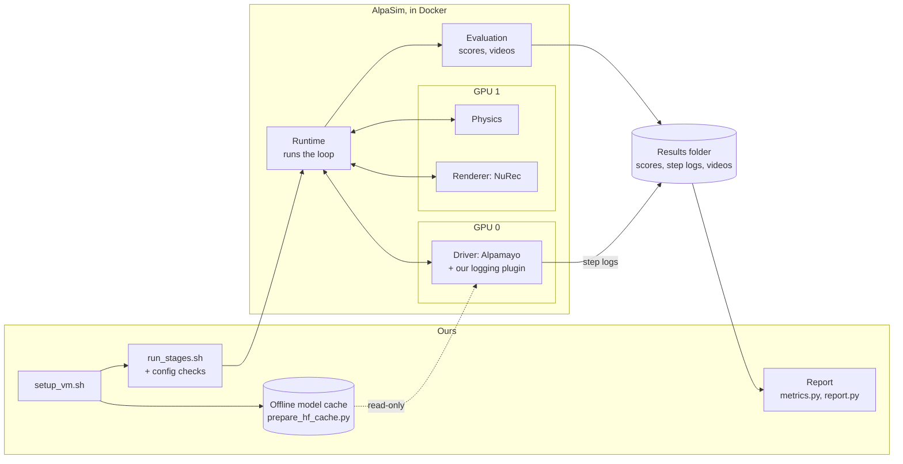

# Architecture

AlpaSim runs the simulation and calls the model at each step. We add a thin plugin
around AlpaSim's own model code, plus scripts that set up the VM, run the
benchmark in stages, and write the report.

## The parts

**Setup scripts (ours).** `bootstrap_vm.sh` installs the NVIDIA driver (only on a VM
with none), Docker, and the NVIDIA Container Toolkit. `setup_vm.sh` then puts
everything large on the data disk, installs AlpaSim at a fixed commit, installs our
plugin into AlpaSim's Python environment, downloads the model and scenes, builds
AlpaSim's Docker images, and checks the generated configs.

**Offline model cache (ours).** `prepare_hf_cache.py` downloads exactly the Hugging
Face files the model needs. Hugging Face is the site that hosts the model weights.
It then loads the model with networking turned off, to prove nothing is missing.
AlpaSim mounts this cache read-only into the driver container.

**Stage runner and config checks (ours).** `run_stages.sh` runs one AlpaSim run per
scene. Before any GPU time is spent, `check_config` reads the files AlpaSim
generated and checks them: the model, which GPU each service uses, the offline
settings, and our plugin's mounts. After each scene, `check_run` checks that the
outputs exist and parse.

**Runtime (AlpaSim).** Steps the simulation at 10 Hz. Each step it asks the renderer
for camera images, sends them to the driver, and passes the driver's planned path
to the controller and physics.

**Driver (AlpaSim, with our plugin).** Runs the model. Alpamayo takes four camera
views and recent motion, writes a short "chain of causation" explaining its
decision, and outputs a trajectory: 64 future positions, 0.1 s apart. Our plugin
wraps AlpaSim's own driver class. It passes each trajectory back unchanged, and
records it with the reasoning text, the timing, the GPU memory, and any validator
flags.

**Renderer (NVIDIA's NuRec, run by AlpaSim).** Draws camera images of a real
recorded drive from new viewpoints, using a 3D reconstruction of that drive (3D
Gaussian splatting). This lets the car leave the recorded path.

**Controller and physics (AlpaSim).** The controller turns the planned path into the
car's motion, using a simple vehicle model; it runs on the CPU. Physics keeps the car
and other road users on the road surface.

**Evaluation (AlpaSim).** Scores each run (collisions, off-road, progress along the
route) and renders the videos.

**Report (ours).** Reads AlpaSim's scores and our step logs, and writes tables,
charts, GPU memory peaks, and the worst drives with the model's reasoning just
before each failure. It also adds jerk (how abruptly acceleration changes), which
AlpaSim does not compute.

## Two integration paths

1. **AlpaSim plugin (used now, for Alpamayo).** AlpaSim drives the loop and calls
   the model. Status: built and tested offline; Alpamayo 2 Super has passed stages 1
   and 2 on a real 2-GPU VM. Stage 3 (all scenes) and Alpamayo 1.5 are not run yet.
2. **Agent layer (for general vision-language models, deferred).** Here our own loop
   drives the simulator. Each step it builds a text-and-image prompt, calls the
   model, parses its text answer into an action, checks the action, and falls back
   to a safe action if parsing or checking fails.
   - Built and tested, against a mock 2D simulator only: the loop, prompt
     building, the parser, the validator, the safety check, and the fallback.
   - Not built yet: the model server adapter (vLLM), the MCP tool server, and the
     connection to a real simulator (`real_env.py` is a stub).

## Key design decisions

- **Wrap AlpaSim's driver; don't rewrite it.** The model's preprocessing must match
  NVIDIA's exactly, and AlpaSim already does that. A wrapper adds logging without
  any risk of changing the model's behavior.
- **Flag-only validation.** Our validator checks each trajectory against speed and
  acceleration limits and records any violation, but never replaces the trajectory.
  Replacing it would hide the model's mistakes and change what AlpaSim scores.
- **Offline model loading.** The driver container has no Hugging Face token. Online,
  a gated model answers "not allowed" even for optional files that don't exist, and
  loading crashes. Offline, against a cache we checked in advance, a missing file
  fails at once with a clear error.
- **2-GPU layout for Alpamayo 2 Super.** The model runs alone on GPU 0, and the
  renderer and physics run on GPU 1. Measured on an A100 80 GB:

  | Service | GPU | Memory |
  |---|---|---|
  | Driver | 0 | 69.5 GiB |
  | Renderer | 1 | 8.8 GiB |
  | Physics | 1 | 0.5 GiB |

  Together that is about 78.8 GiB of the GPU's 80 GiB. That leaves too little
  headroom to put all three on one GPU safely.
  AlpaSim's own 2-GPU layout starts 3 copies of the driver on one GPU, so we use our own.
- **Three stages.** Stage 1 runs AlpaSim's driver unchanged, so a failure there is a
  setup problem, not ours. Stage 2 adds our plugin on the same scene. Stage 3 runs
  every scene only once both have passed, so a broken setup can't waste hours of
  GPU time.
